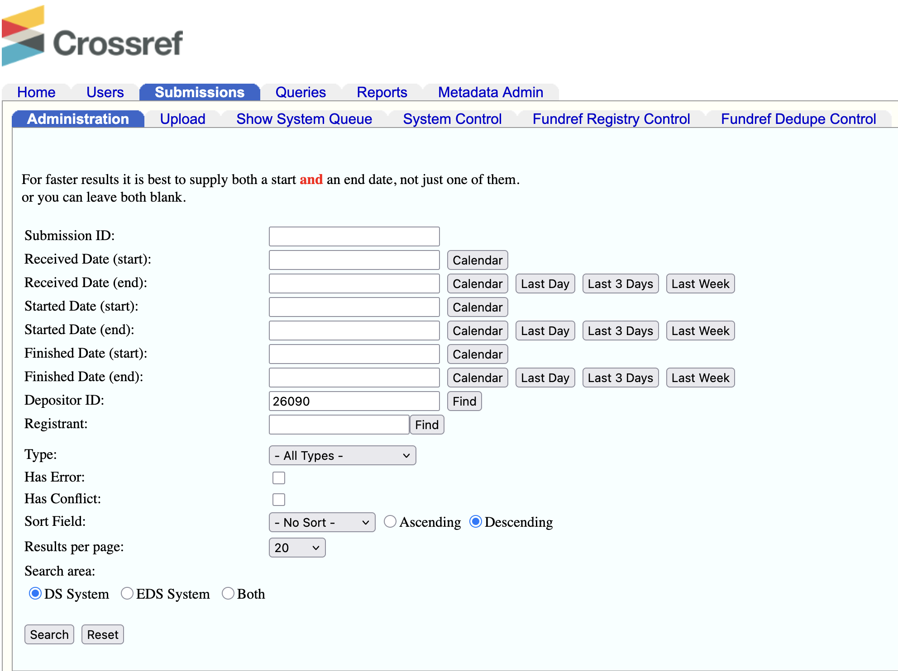
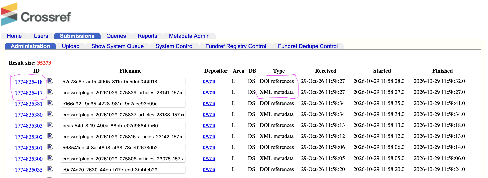

# Open Journal System {.unnumbered}

## Resources

### Metadata Guide in OJS

-   [Erudit Metadata Guide](https://www.erudit.org/public/guides/ojs-metadata.pdf)

### OJS 3.5 Manual

-   [Publication and post-publication](https://docs.pkp.sfu.ca/learning-ojs/editorial-workflow/en/publication.html)

-   [Using OJS for multiple languages](https://docs.pkp.sfu.ca/multiling-guide/en/)

Updating metadata

Should you need to update an published article, you will need to first unpublish the article, make the necessary adjustments, then republish. Once you have done this, you may need to push the metadata to Crossref. Go to DOI, then select the article, and under 'Bulk Actions' you can select 'Deposit DOIs'. This will ask you for confirmation.

You should receive a confirmation email, (if your email is in the Settings for the Crossref XML Plugin). If not, you can confirm by logging into the [Admin tool](https://doi.crossref.org/servlet/useragent) at Crossref with the role crendentials, *uwon* and the password. You will need to select the Submissions main tab, the Administration sub-tab and put '26090' (which is the user id for the role *uwon*) in the Depositor ID text box. You can limit the search with a date range or just select 'Search' and it will return all submissions made on the role *uwon*. Remember, this role is organization-wide for Western Ontario, so you will see all submissions for the organization, not just for CJILS. The best way to find the files you want is to filter by date.

{fig-align="center"}

For each DOI you deposit, you will see two submissions with the types 'DOI references' and XML metadata'. The XML metadata submission contains everything except the references, which are supplied separately in a resource-only deposit. In the example below, you can see two submission IDs on the left.

{fig-align="center"}

Selecting one of them will take you to a detail page where you can see the submission diagnostics message should you encounter any errors. You can find a troubleshooting guide on interpreting these messages in the [Crossref Documentation](https://www.crossref.org/documentation/register-maintain-records/verify-your-registration/troubleshooting-submissions/).